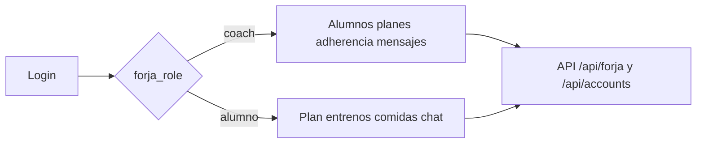

# Arquitectura — Forja

SPA Vite con dos superficies después del login: coach y alumno. La landing y el login están fuera del shell autenticado.

## Estructura

```
src/pages          landing, login, coach/*, alumno/*
src/lib/api        cliente Yggdra y llamadas del dominio Forja, más el demo
src/components     shell, tema, ui
e2e                flujos demo y la suite real
docs               contrato, auditoría, informe PDF
```

## Flujo



El base path `/forja/` existe para GitHub Pages. En local Vite usa el mismo prefijo.

## Staging

El CD no usa `upload-pages-artifact`. Compila y deja el estático en la raíz de `main`, que es la fuente legacy de Pages. Por eso `assets/`, `404.html` e `index.html` de producción están versionados. Cambiar ese mecanismo es un cambio de deploy, fuera del alcance de la documentación.
